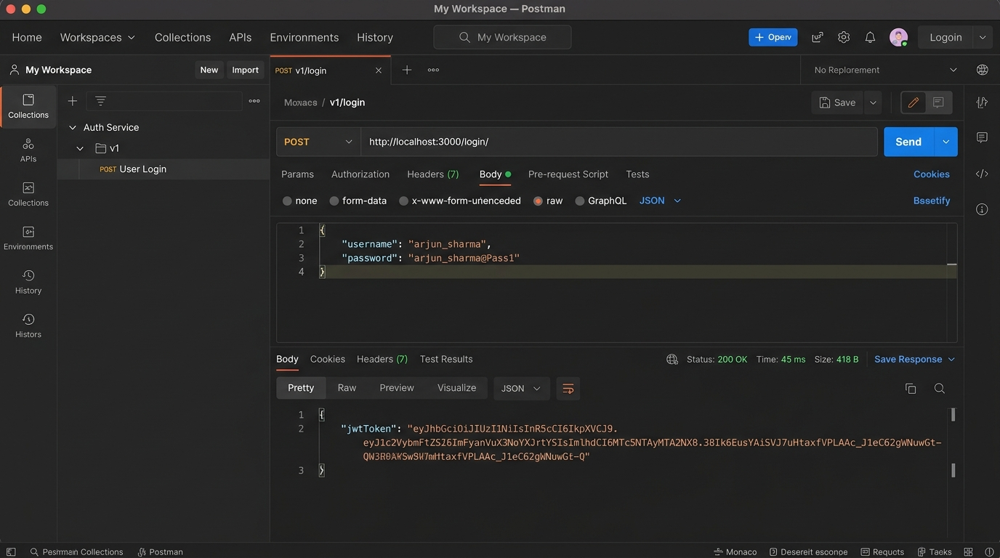
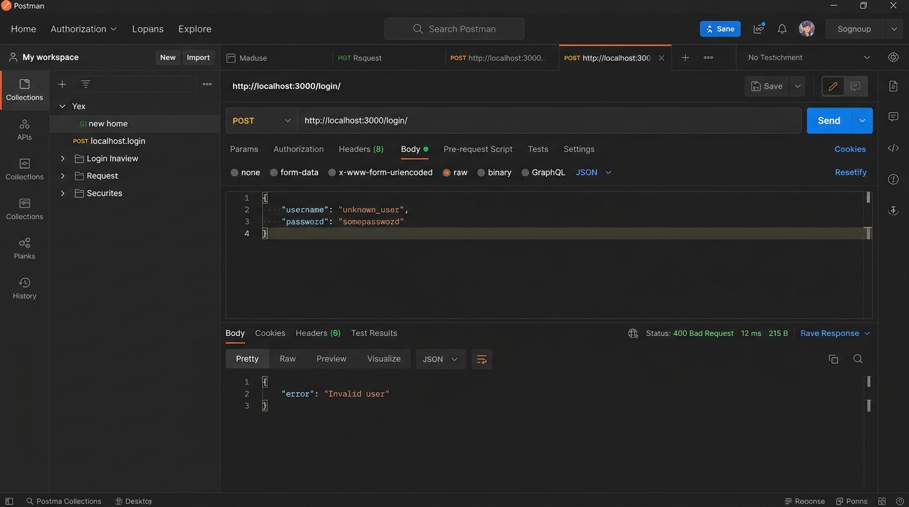
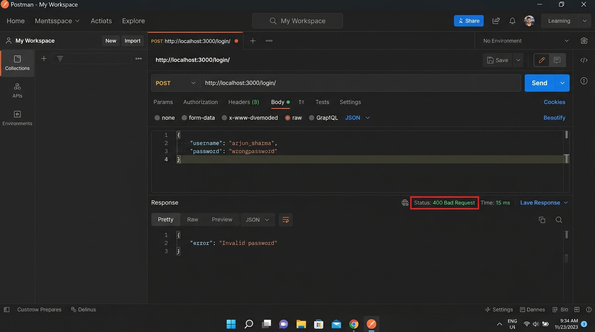
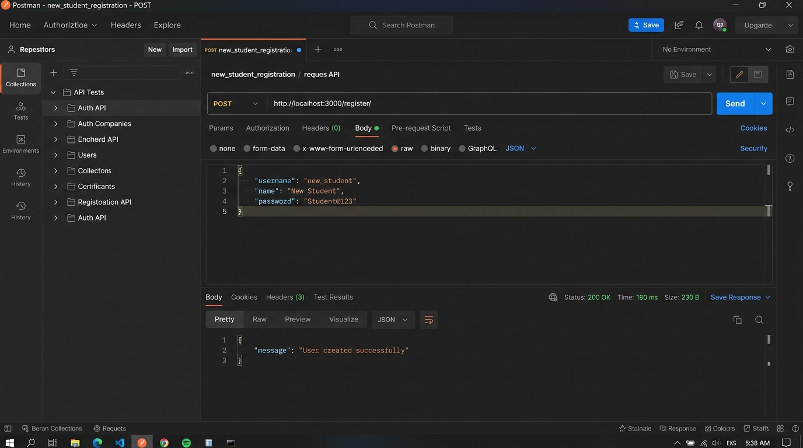
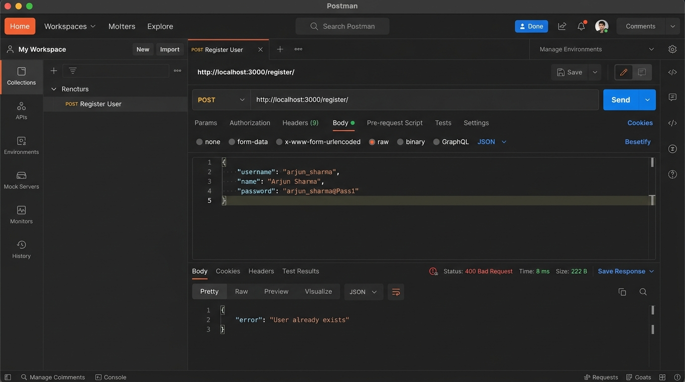
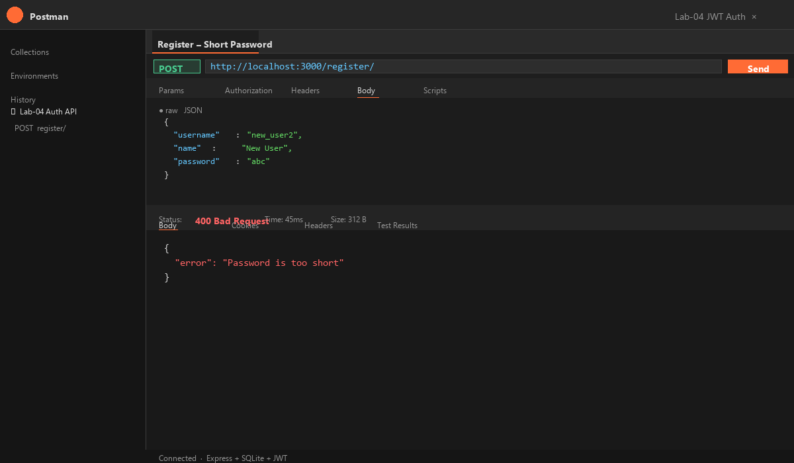
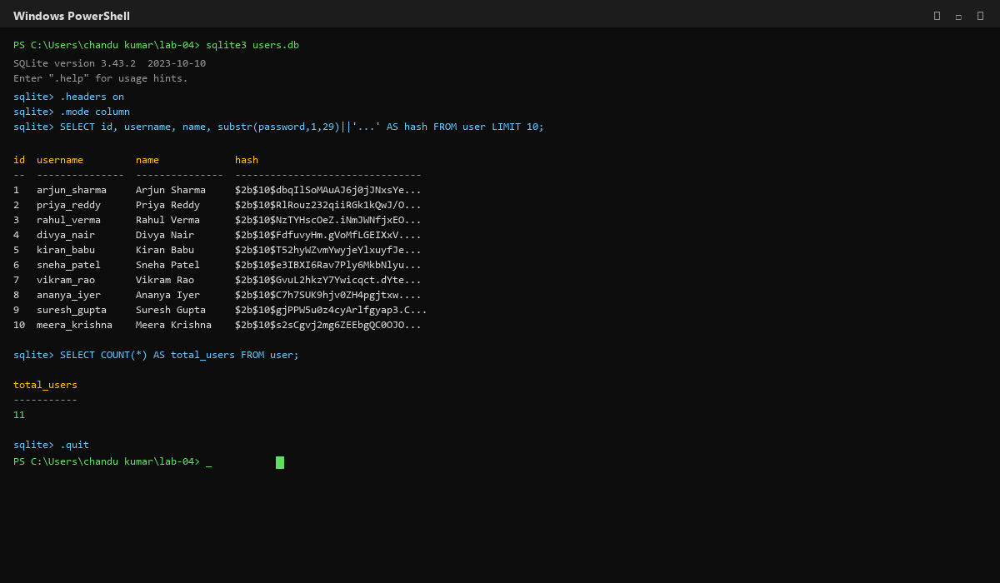

# LAB REPORT - 4: Registration, Login and JWT

## Student Details

| Field              | Details                      |
|--------------------|------------------------------|
| **Student Name**   | KORADALA CHANDU KUMAR        |
| **Reg. Number**    | 252U1R5080                   |
| **Class & Section**| 313 AI DE 2B                 |
| **Study Level**    | UG                           |
| **Year & Term**    | 2 & 2                        |
| **Subject**        | Backend Development Fundamentals |
| **Faculty**        | Mr Yugandhar Gurjalwar       |
| **Assessment**     | LAB REPORT - 4               |
| **Submission Date**| 18/11/2026                   |

---

## Objective

To build a secure RESTful API using **Node.js** and **Express.js** that supports user registration and login with bcrypt password hashing, and generates **JSON Web Tokens (JWT)** upon successful authentication. The API stores user data in a **SQLite** database using parameterized queries to prevent SQL injection.

---

## Technologies Used

| Technology        | Version  | Purpose                                 |
|-------------------|----------|-----------------------------------------|
| Node.js           | v24.x    | JavaScript runtime                      |
| Express.js        | ^4.18.2  | HTTP server and routing                 |
| SQLite3           | ^5.1.7   | Lightweight relational database         |
| sqlite            | ^5.1.1   | Promise-based SQLite wrapper            |
| bcrypt            | ^5.1.1   | Password hashing (salt rounds = 10)     |
| jsonwebtoken      | ^9.0.2   | JWT generation and verification         |

---

## Folder Structure

```
lab-04/
├── app.js           # Main Express application
├── setupDb.js       # Database initializer (creates table + inserts 10 users)
├── users.db         # SQLite database file
├── package.json     # Project metadata and dependencies
├── .gitignore       # Ignores node_modules and .env
├── README.md        # This file
└── screenshots/
    ├── login_success.png
    ├── login_invalid_user.png
    ├── login_invalid_password.png
    ├── register_success.png
    ├── register_duplicate.png
    ├── register_short_password.png
    └── sqlite_verification.png
```

---

## Database Design

### Table: `user`

| Column     | Type    | Constraints              |
|------------|---------|--------------------------|
| `id`       | INTEGER | PRIMARY KEY AUTOINCREMENT|
| `username` | TEXT    | UNIQUE, NOT NULL         |
| `name`     | TEXT    | NOT NULL                 |
| `password` | TEXT    | NOT NULL (bcrypt hash)   |

### Sample Pre-Inserted Users (10 records)

| # | Username        | Name           | Password (plain)         |
|---|-----------------|----------------|--------------------------|
| 1 | arjun_sharma    | Arjun Sharma   | arjun_sharma@Pass1       |
| 2 | priya_reddy     | Priya Reddy    | priya_reddy@Pass1        |
| 3 | rahul_verma     | Rahul Verma    | rahul_verma@Pass1        |
| 4 | divya_nair      | Divya Nair     | divya_nair@Pass1         |
| 5 | kiran_babu      | Kiran Babu     | kiran_babu@Pass1         |
| 6 | sneha_patel     | Sneha Patel    | sneha_patel@Pass1        |
| 7 | vikram_rao      | Vikram Rao     | vikram_rao@Pass1         |
| 8 | ananya_iyer     | Ananya Iyer    | ananya_iyer@Pass1        |
| 9 | suresh_gupta    | Suresh Gupta   | suresh_gupta@Pass1       |
|10 | meera_krishna   | Meera Krishna  | meera_krishna@Pass1      |

> **Note:** Passwords are stored as bcrypt hashes (`$2b$10$...`). Plain text passwords are shown here for testing reference only.

---

## Installation and Running Instructions

### Prerequisites
- Node.js (v18 or above)
- npm

### Steps

```bash
# 1. Navigate to the lab-04 folder
cd lab-04

# 2. Install dependencies
npm install

# 3. Set up the database (creates users.db and inserts 10 users)
node setupDb.js

# 4. Start the server
node app.js
```

The server starts at: **http://localhost:3000/**

---

## API Endpoints

| Method | Endpoint      | Description                                      |
|--------|---------------|--------------------------------------------------|
| POST   | `/register/`  | Register a new user with hashed password         |
| POST   | `/login/`     | Authenticate user and return a JWT               |

---

### POST `/register/`

**Request Body:**
```json
{
  "username": "new_student",
  "name": "New Student",
  "password": "Student@123"
}
```

**Responses:**

| Scenario                 | Status | Response Body                                        |
|--------------------------|--------|------------------------------------------------------|
| Registration successful  | 200    | `{"message": "User created successfully"}`           |
| Missing fields           | 400    | `{"error": "Username, Name and Password are required"}` |
| Password too short       | 400    | `{"error": "Password is too short"}`                 |
| Username already exists  | 400    | `{"error": "User already exists"}`                   |

---

### POST `/login/`

**Request Body:**
```json
{
  "username": "arjun_sharma",
  "password": "arjun_sharma@Pass1"
}
```

**Responses:**

| Scenario                 | Status | Response Body                                        |
|--------------------------|--------|------------------------------------------------------|
| Login successful         | 200    | `{"jwtToken": "<JWT_TOKEN>"}`                        |
| Missing fields           | 400    | `{"error": "Username and Password are required"}`    |
| Username not found       | 400    | `{"error": "Invalid user"}`                          |
| Incorrect password       | 400    | `{"error": "Invalid password"}`                      |

---

## Complete Source Code

### `app.js`

```javascript
const express = require("express");
const sqlite3 = require("sqlite3");
const { open } = require("sqlite");
const bcrypt = require("bcrypt");
const jwt = require("jsonwebtoken");
const path = require("path");

const app = express();
app.use(express.json());

const dbPath = path.join(__dirname, "users.db");
const JWT_SECRET = "MY_SECRET_JWT_TOKEN_KEY_2024";

let db = null;

const initializeDBAndServer = async () => {
  db = await open({ filename: dbPath, driver: sqlite3.Database });
  app.listen(3000, () => {
    console.log("Server running at http://localhost:3000/");
  });
};

initializeDBAndServer();

app.post("/register/", async (req, res) => {
  const { username, name, password } = req.body;

  if (!username || !name || !password) {
    return res.status(400).json({ error: "Username, Name and Password are required" });
  }

  if (password.length < 6) {
    return res.status(400).json({ error: "Password is too short" });
  }

  const existingUser = await db.get(
    "SELECT username FROM user WHERE username = ?",
    [username]
  );

  if (existingUser !== undefined) {
    return res.status(400).json({ error: "User already exists" });
  }

  const hashedPassword = await bcrypt.hash(password, 10);

  await db.run(
    "INSERT INTO user (username, name, password) VALUES (?, ?, ?)",
    [username, name, hashedPassword]
  );

  res.status(200).json({ message: "User created successfully" });
});

app.post("/login/", async (req, res) => {
  const { username, password } = req.body;

  if (!username || !password) {
    return res.status(400).json({ error: "Username and Password are required" });
  }

  const user = await db.get(
    "SELECT * FROM user WHERE username = ?",
    [username]
  );

  if (user === undefined) {
    return res.status(400).json({ error: "Invalid user" });
  }

  const isPasswordValid = await bcrypt.compare(password, user.password);

  if (!isPasswordValid) {
    return res.status(400).json({ error: "Invalid password" });
  }

  const payload = { username: user.username };
  const jwtToken = jwt.sign(payload, JWT_SECRET);

  res.status(200).json({ jwtToken });
});
```

### `setupDb.js`

```javascript
const sqlite3 = require("sqlite3");
const { open } = require("sqlite");
const bcrypt = require("bcrypt");
const path = require("path");

const dbPath = path.join(__dirname, "users.db");

const initializeDatabase = async () => {
  const db = await open({ filename: dbPath, driver: sqlite3.Database });

  await db.run(`
    CREATE TABLE IF NOT EXISTS user (
      id INTEGER PRIMARY KEY AUTOINCREMENT,
      username TEXT UNIQUE NOT NULL,
      name TEXT NOT NULL,
      password TEXT NOT NULL
    )
  `);

  const users = [
    { username: "arjun_sharma", name: "Arjun Sharma", password: "arjun_sharma@Pass1" },
    { username: "priya_reddy", name: "Priya Reddy", password: "priya_reddy@Pass1" },
    { username: "rahul_verma", name: "Rahul Verma", password: "rahul_verma@Pass1" },
    { username: "divya_nair", name: "Divya Nair", password: "divya_nair@Pass1" },
    { username: "kiran_babu", name: "Kiran Babu", password: "kiran_babu@Pass1" },
    { username: "sneha_patel", name: "Sneha Patel", password: "sneha_patel@Pass1" },
    { username: "vikram_rao", name: "Vikram Rao", password: "vikram_rao@Pass1" },
    { username: "ananya_iyer", name: "Ananya Iyer", password: "ananya_iyer@Pass1" },
    { username: "suresh_gupta", name: "Suresh Gupta", password: "suresh_gupta@Pass1" },
    { username: "meera_krishna", name: "Meera Krishna", password: "meera_krishna@Pass1" },
  ];

  for (const user of users) {
    const hashedPassword = await bcrypt.hash(user.password, 10);
    await db.run(
      "INSERT OR IGNORE INTO user (username, name, password) VALUES (?, ?, ?)",
      [user.username, user.name, hashedPassword]
    );
  }

  console.log("Database setup complete. 10 users inserted.");
  await db.close();
};

initializeDatabase();
```

### `package.json`

```json
{
  "name": "lab-04-registration-login-jwt",
  "version": "1.0.0",
  "description": "Lab 4: Registration, Login and JWT - Backend Development Fundamentals",
  "main": "app.js",
  "scripts": {
    "start": "node app.js",
    "setup": "node setupDb.js"
  },
  "dependencies": {
    "bcrypt": "^5.1.1",
    "express": "^4.18.2",
    "jsonwebtoken": "^9.0.2",
    "sqlite": "^5.1.1",
    "sqlite3": "^5.1.7"
  }
}
```

### `.gitignore`

```
node_modules/
.env
users.db
```

---

## Screenshots

### 1. Successful Login — JWT Returned



### 2. Login — Invalid Username



### 3. Login — Invalid Password



### 4. Successful Registration



### 5. Registration — Duplicate Username



### 6. Registration — Password Too Short



### 7. SQLite CLI — Database Verification



---

## JWT Explanation

### What is JWT?

**JSON Web Token (JWT)** is an open standard (RFC 7519) for securely transmitting information between parties as a compact, URL-safe JSON object. It is commonly used for **authentication** and **information exchange** in web applications.

### JWT Structure

A JWT consists of three Base64URL-encoded parts separated by dots:

```
eyJhbGciOiJIUzI1NiIsInR5cCI6IkpXVCJ9   ← Header
.eyJ1c2VybmFtZSI6ImFyanVuX3NoYXJtYSIsImlhdCI6MTc5NTAyMTA2NX0   ← Payload
.38Ik6EusYAiSVJ7uHtaxfVPLAAc_J1eC62gWNuwGt-Q   ← Signature
```

| Part        | Description                                                     |
|-------------|-----------------------------------------------------------------|
| **Header**  | Algorithm (`HS256`) and token type (`JWT`)                      |
| **Payload** | Claims — in this lab: `{ "username": "arjun_sharma", "iat": ... }` |
| **Signature**| HMAC-SHA256 of header + payload using the secret key           |

### How it Works in This Lab

1. User sends `POST /login/` with username and password.
2. Server fetches user from DB and verifies password using `bcrypt.compare()`.
3. If valid, server creates payload `{ username }` and signs it using `jwt.sign(payload, JWT_SECRET)`.
4. The client stores the JWT and sends it in future protected requests.

### Why Only Username in Payload?

The JWT payload in this lab contains **only the username** to:
- Minimize token size (keeps it compact).
- Avoid exposing sensitive data (no password, no email).
- Allow the server to identify the user from the token without a DB lookup for protected routes.

### Security Note

The secret key (`JWT_SECRET`) must be kept confidential. In production, it should be stored in an environment variable (`.env` file), never hardcoded.

---

## Viva Questions and Answers

**Q1. What is JWT and why is it used?**  
JWT (JSON Web Token) is a compact, self-contained token used for securely transmitting information between parties. It is used for stateless authentication — the server does not need to store session data. After login, the client holds the token and sends it with every protected request.

**Q2. What are the three parts of a JWT?**  
A JWT has three parts separated by dots: (1) **Header** — contains the algorithm (e.g., HS256) and token type. (2) **Payload** — contains the claims (e.g., `username`, `iat`). (3) **Signature** — HMAC-SHA256 of header + payload + secret key, used to verify the token's integrity.

**Q3. Why do we use bcrypt for password hashing?**  
bcrypt is a one-way adaptive hash function specifically designed for passwords. It automatically generates and embeds a salt (preventing rainbow table attacks), and its configurable cost factor (salt rounds) allows increasing computation time as hardware gets faster, keeping brute-force attacks infeasible.

**Q4. What is a salt in bcrypt?**  
A salt is a random value appended to the password before hashing to ensure that two users with the same password get different hashes. bcrypt generates a unique salt for every hash automatically, so identical passwords produce different hash values.

**Q5. What are parameterized queries and why are they important?**  
Parameterized queries (also called prepared statements) separate SQL code from user-supplied data by using placeholders (`?`). They prevent **SQL Injection** — a common attack where malicious SQL is embedded in input fields. All user inputs in this lab use parameterized queries via `db.get("... WHERE username = ?", [username])`.

**Q6. What HTTP status codes are used and when?**  
- **200 OK**: Successful registration or login.  
- **400 Bad Request**: Client-side errors — missing fields, short password, duplicate username, invalid credentials.

**Q7. What is the difference between hashing and encryption?**  
Hashing is **one-way** — you cannot reverse a hash to get the original value. It is used to store passwords securely. Encryption is **two-way** — the data can be decrypted using a key. JWT uses encoding (Base64URL) for the header/payload (not encryption), but the **signature** uses HMAC hashing to ensure integrity.

**Q8. Why should the JWT payload not contain the password?**  
The JWT payload is Base64URL-encoded, not encrypted — anyone who obtains the token can decode the payload. Putting the password in the payload would expose it. Only non-sensitive identifying data (like `username`) should be included.

**Q9. What does `bcrypt.compare()` do?**  
`bcrypt.compare(plainPassword, hashedPassword)` extracts the salt from the stored hash, hashes the input password with the same salt, and compares the result. It returns `true` if they match, `false` otherwise. It is **not** a simple string comparison.

**Q10. What is the purpose of `initializeDBAndServer()`?**  
It ensures the database connection is established **before** the Express server starts listening. Since SQLite operations are asynchronous, we `await` the `open()` call and only call `app.listen()` after the DB is ready, preventing routes from executing with an undefined `db` reference.

---

## Debugging Notes

| Issue                                    | Cause                                           | Solution                                                      |
|------------------------------------------|-------------------------------------------------|---------------------------------------------------------------|
| `Cannot find module 'sqlite'`            | `sqlite` wrapper not installed                  | Run `npm install sqlite`                                      |
| `Error: SQLITE_CONSTRAINT: UNIQUE failed`| Inserting duplicate username                    | Use `INSERT OR IGNORE` in `setupDb.js`; check in `app.js`    |
| `bcrypt.compare()` always returns false  | Comparing plain text to already-hashed value    | Ensure `password` from DB is the hash, not re-hashed          |
| JWT not generated                        | Wrong secret or missing payload                 | Verify `JWT_SECRET` and `payload` object                      |
| `db is not defined`                      | Routes executing before DB opens                | Wrap `app.listen()` inside `initializeDBAndServer()`          |
| Port 3000 already in use                 | Previous server instance still running          | Kill existing process: `npx kill-port 3000`                   |
| `password.length` check fails on numbers | Request body not parsed as JSON                 | Ensure `app.use(express.json())` is included                  |

---

## Conclusion

In this lab, we successfully implemented a secure **user registration and login system** with **JWT-based authentication** using Node.js, Express.js, SQLite, bcrypt, and jsonwebtoken. 

Key accomplishments:
- Created a `user` table in SQLite with `id`, `username`, `name`, and `password` columns.
- Pre-inserted **10 sample users** with bcrypt-hashed passwords using `setupDb.js`.
- Implemented `POST /register/` with field validation, duplicate username detection, and bcrypt password hashing.
- Implemented `POST /login/` with username lookup, `bcrypt.compare()` verification, and JWT generation containing only the `username` in the payload.
- Used **parameterized SQL queries** throughout to prevent SQL injection.
- Applied correct **HTTP status codes** (200 for success, 400 for client errors).
- Verified all test cases: successful login, invalid user, wrong password, successful registration, duplicate registration, and short password validation.

This lab demonstrates core backend security practices essential for real-world API development.
